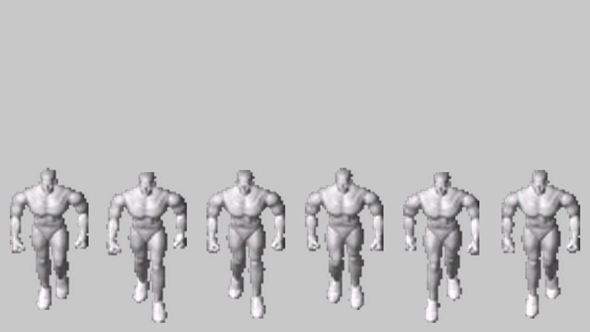
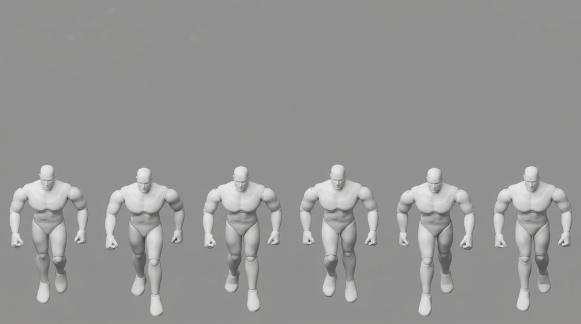
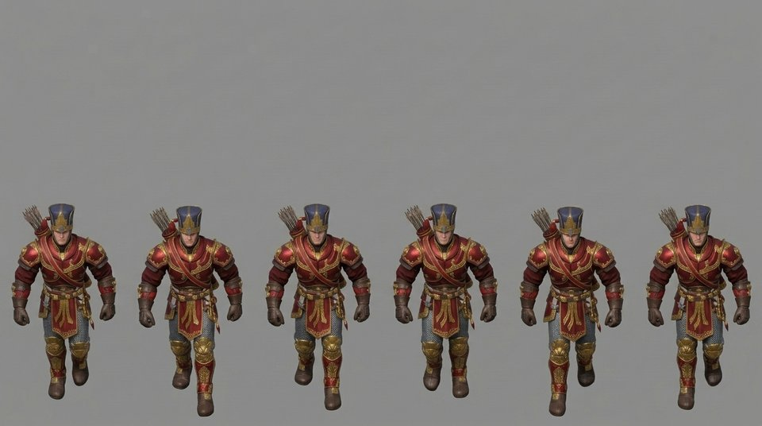
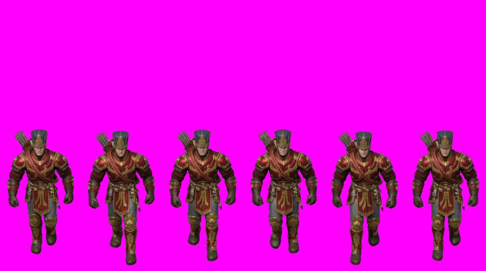
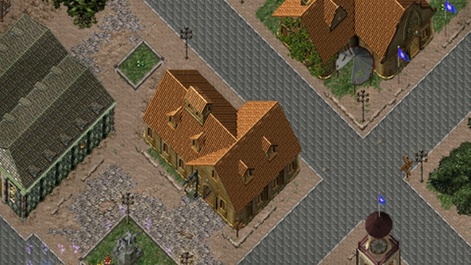
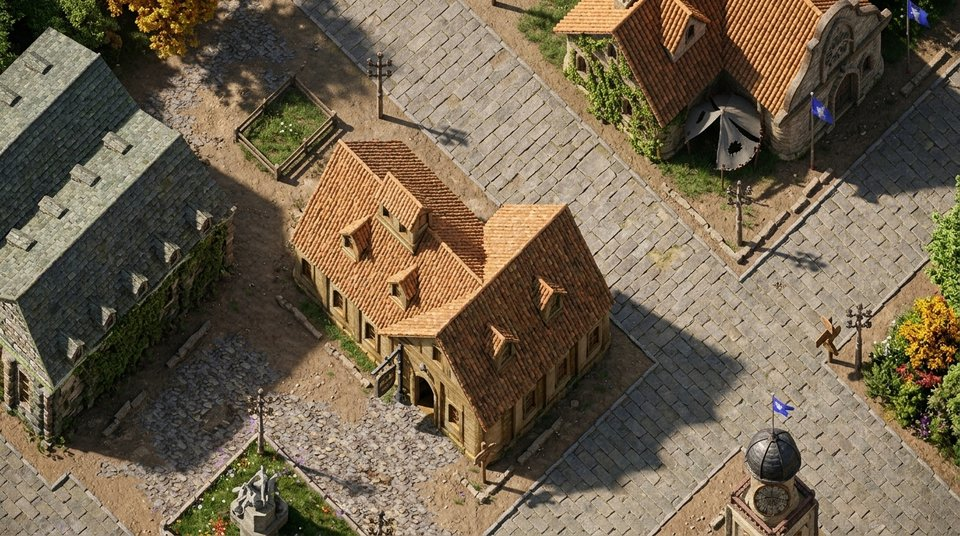

# Como foi feito o Thief em HD (e a vila)

Este é o passo a passo usado para transformar o boneco do Dragon Raja em um personagem HD com cara de Unreal, mantendo exatamente as poses e o ritmo das animações originais. No fim tem também como a vila de Helternt foi refeita em HD e como o vídeo foi montado.

Resumindo a ideia: **o jogo dá as poses e a IA só troca a roupa e a resolução.** Quando a IA desenha o personagem andando do zero, ele parece deslizar no chão. Quando ela redesenha em cima dos sprites do jogo, o passo sai certo.

Os resultados estão em `../personagens/thief/`.

---

## Ferramentas

| O quê | Para quê |
|---|---|
| **Google Flow** (flow.google.com) | Gera as imagens com o modelo de imagem do Google. Usa créditos da conta. |
| **google-flow-mcp** (código aberto, licença MIT: https://github.com/RohaanA/google-flow-mcp) | Deixa o Claude (ou um script) comandar o Flow: gerar imagem, mandar referência e baixar o resultado. Funciona por um Chrome logado na conta do Google. |
| **Claude Code** | Rodou tudo: leu os arquivos do jogo, escreveu os scripts, conferiu cada resultado e refez o que saiu errado. |
| Python (Pillow, numpy, opencv) | Recorte, alinhamento, GIFs e montagem do vídeo. |
| ffmpeg | Gera o MP4. |
| Real-ESRGAN (modelo x4plus) | Aumenta a vila em 4x sem perder nitidez. |

### Ligando o Flow pelo MCP

1. Instale o google-flow-mcp seguindo o README dele (`npm install` e `npm run build`).
2. Abra um Chrome separado, com perfil próprio e porta de depuração:
   `chrome --remote-debugging-port=9222 --user-data-dir=C:\ferramentas\perfil-flow`
   Faça login no Google uma vez nesse Chrome.
3. Cadastre o MCP no Claude Code apontando para `dist/index.js`, com as variáveis `FLOW_CDP_URL=http://127.0.0.1:9222`, `FLOW_PROFILE_DIR` (pasta do perfil) e `FLOW_MAX_CREDITS_PER_CALL=20`, que é uma trava para não gastar créditos demais numa chamada.
4. Para chamar de dentro de script, sem o Claude, use `scripts/flow/flow.mjs`:
   `node flow.mjs flow_generate_image '{"project_id":"...","prompt":"...","reference_media_ids":["..."]}'`
   `scripts/flow/subir.mjs` manda uma imagem do PC como referência para o projeto do Flow.
5. Feche esse Chrome quando terminar.

---

## Parte 1: ler o boneco do jogo

- O corpo masculino fica em `Char/001000.spr`. `scripts/jogo/spr_decode.py` abre esse arquivo e devolve cada quadro com fundo transparente e o "ponto do pé" (âncora), que é onde o boneco pisa.
- Há 75 quadros por direção, em 8 direções, nesta ordem: S, SW, W, NW, N, NE, E, SE.
- A tabela `Char/001AniTable.bin` diz quais quadros formam cada animação. São registros de 404 bytes a partir do byte 21: nº de quadros no byte 0, lista de quadros a partir do byte 4 e deslocamento por tique a partir do byte 84.
  - Parado (animação 0): quadros 1, 2, 3, 2.
  - Andar (animação 1): quadros 4 a 9, andando 6 a 7 px por tique.
  - Correr (animação 12): quadros 44 a 49, correndo 10 px por tique.
  - Cada quadro dura 2 tiques.

## Parte 2: sprites → manequim HD → Thief (por direção e por ação)

1. **Folha de sprites** (`scripts/sprites/folha_manequins.py`): coloca os 6 quadros da animação lado a lado numa imagem 16:9 com fundo cinza, todos no mesmo chão e ampliados cerca de 7 vezes. O parado usa 1, 2, 3, 1, 2, 3 para ter 6 bonecos também. Como todos são alinhados pelo pé do jogo, o sobe e desce do passo continua igual.
2. **Manequim HD** (Flow): a folha vai como referência, com o pedido de refazer em alta resolução com manequins brancos de artista e de manter exatamente as poses, a ordem, o tamanho, o ângulo de câmera e para onde cada boneco está virado. O manequim branco deixa a pose limpa antes de a roupa entrar.
3. **Vestir o Thief** (Flow): vão duas referências, a folha de manequins e uma ficha do personagem, com o Thief de frente, 3/4, perfil e costas. O pedido é vestir os 6 manequins com essa roupa sem mudar pose, tamanho nem posição. A roupa é túnica vermelha e dourada, chapéu azul com placa dourada e borla vermelha, aljava nas costas, calça de cota de malha e botas com caneleira dourada.
4. **Conferir o tamanho**: o Flow às vezes dá zoom, principalmente em vista de costas. O script mede a altura dos bonecos e compara com a do sprite multiplicada por 5,6. Se passar de 10% para mais ou para menos, gera de novo, até 4 vezes.
5. **Recorte** (`scripts/sprites/recorte_fino.py`): acha o fundo cinza a partir das bordas, suaviza a borda do personagem e tira o cinza que ficou misturado na cor, o que evita o contorno claro.
6. **Separar os quadros** (`scripts/sprites/cortar_quadros.py`): acha cada boneco na folha, iguala altura e chão e salva PNGs de 320x510. Quando dois bonecos se encostam, divide pela "fresta" entre eles.
7. **Limpar sobras** (`scripts/sprites/limpar_quadros.py`): tira as manchas cinzas que ficam presas entre flechas, borla e chapéu.
8. **GIFs** (`scripts/sprites/animar.py`).

`scripts/sprites/pipeline.py` faz as etapas 1 a 5 sozinho para várias direções: `python pipeline.py S SW W NW N NE E SE`. Ele pula o que já está pronto, então se algo der errado é só apagar o arquivo daquela etapa e rodar de novo.

Os prompts completos estão dentro de `pipeline.py`.

### Armadilhas que custaram tempo

- **Nome de arquivo repetido no Flow**: o Flow acha a imagem enviada pelo nome. Se duas direções mandarem `andar.png`, ele pega a errada. Use nomes únicos, como `S_andar_manequim_baixa.png`.
- **"No image named ..." logo depois de enviar** é só atraso do Flow. Tente de novo.
- **Folha com bonecos a menos**: às vezes o Flow devolve 5 bonecos em vez de 6. Se o corte for por colunas fixas, ele corta um braço. Por isso o corte procura cada boneco.
- **Corrida de lado**: as pernas abertas encostam na borda do quadro. Por isso o quadro tem 320 px de largura, e não 260.
- **Um quadro por vez não funciona**: gerar cada quadro sozinho faz cada um sair um pouco diferente, e a animação treme e desliza. Gerar os 6 juntos numa folha deixa todos com a mesma cara.

## Parte 3: a vila de Helternt em HD

1. **Base**: um mosaico montado com prints do jogo (1 px do mosaico = 4 px do jogo). O mapa decodificado direto dos arquivos tinha elementos faltando, então os prints serviram melhor.
2. **Recorte** de 480x270 do mosaico, que equivale a 1920x1080 do jogo, no cruzamento perto da placa (`scripts/vila/vila.py cruzamento`).
3. **Flow** com este prompt:
   > Recreate this dark fantasy mmorpg village on unreal engine 3d render high quality. Maintain same perspective, same building architecture. Improve quality of materials and textures, ambient illumination, shadows and ambient occlusion.

   Prompts que tentavam travar a posição de cada coisa deixavam o resultado duro. Esse prompt simples deu o melhor visual e manteve o layout.
4. **Ampliar 4x** com Real-ESRGAN (`realesrgan-ncnn-vulkan -n realesrgan-x4plus`), para a câmera poder chegar perto sem borrar.

## Parte 4: o vídeo e a escala certa

- **Régua de tamanho** (`scripts/vila/escala_lado_a_lado.py`): mostra o mesmo cruzamento duas vezes, uma com o mapa original e o boneco do jogo (67 px de altura) e outra com a vila HD e o Thief. Se os dois saem do mesmo tamanho, a escala está certa. **Regra: o Thief usa sempre a mesma escala do cenário.** Primeiro um ficou pequeno demais e depois grande demais, e a régua acabou com esse chute.
- **Caminho**: o Thief segue o eixo medido da rua, não uma linha reta qualquer. Anda até o cruzamento e desce pela diagonal esquerda (SW).
- **Velocidade**: o passo é proporcional ao do jogo (13 px de jogo por quadro andando e 20 correndo, a 10 quadros por segundo), então o pé não escorrega.
- **Sombras**: a sombra comprida é a silhueta do boneco achatada e desfocada. Também tem uma sombra escura e desfocada embaixo dos pés (oclusão de ambiente). Sem ela, ele parecia flutuar.
- **Câmera**: segue o personagem com suavização. Os quadros vão direto para o ffmpeg, em 1080p.
- Script: `scripts/vila/vila_lucas_video.py`. O vídeo das 8 direções é feito por `scripts/video/render_ab.py andar|correr [zoom]`.

---

## Sobre os scripts

Os scripts estão aqui exatamente como rodaram. Os caminhos de pasta foram trocados por caminhos genéricos (`C:/dr-sprites/...`, `C:/DragonRaja/...` e `C:/ferramentas/...`). Para rodar no seu PC, ajuste esses caminhos no topo de cada arquivo. O `project_id` e os ids de mídia do Flow são da conta de quem gerou; numa conta nova, crie um projeto no Flow e envie a sua própria ficha do personagem.
